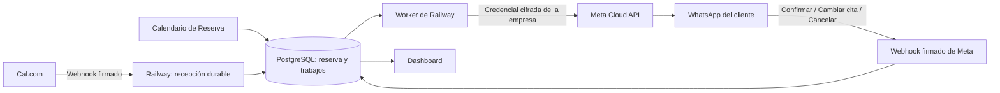

# Reserva: WhatsApp Cloud API con conexión directa y automatización propia

## Cómo funciona

El calendario nativo funciona sin Cal.com. Cal.com es una fuente opcional de reservas. **Make no participa** en el flujo nuevo: `LEGACY_MAKE_ENABLED=false` mantiene sus endpoints antiguos desactivados. No dejar activo un escenario anterior que envíe la misma notificación desde Evolution API, Make u otro proveedor.

Cada reserva nueva autorizada genera una confirmación inmediata y un recordatorio, por defecto 24 horas antes. Son dos mensajes independientes, con plantillas e idempotencia distintas. El propietario puede elegir 24 horas, 2 horas, 1 hora o 30 minutos de anticipación.

Si la fecha está demasiado cerca para esa anticipación, el recordatorio se programa a mitad del tiempo disponible, separado de la confirmación. Si faltan menos de diez minutos, se omite ese segundo aviso. Una reprogramación cancela los trabajos anteriores y crea los correspondientes a la nueva fecha. Puede producir una nueva confirmación; los dos mensajes son el flujo base por fecha, no un límite que impida avisar cambios.

## 1. Registrar un número emisor en Meta

1. En la app de Meta que usa el servidor, abre **WhatsApp → Configuración de producción**. Crea o selecciona la cuenta de WhatsApp Business de tus propios mensajes.
2. En [WhatsApp Manager](https://business.facebook.com/wa/manage/home/), agrega un número dedicado a la API que pueda recibir SMS o llamadas. Completa el código de verificación y el registro que indique Meta. El estado del número debe ser **Conectado**.
3. Añade tu método de pago a esa cuenta de WhatsApp en Meta. Los cargos de Meta se gestionan por separado del plan de Reservas. Consulta las [tarifas de WhatsApp Business Platform](https://business.whatsapp.com/products/platform-pricing).
4. En la configuración empresarial de Meta, asigna a un usuario del sistema la app y la cuenta de WhatsApp. Genera un token de la misma app con los permisos `whatsapp_business_management` y `whatsapp_business_messaging`. Guarda el token en privado y copia el **ID de la cuenta de WhatsApp Business (WABA)** y el **ID del número de teléfono**, que es distinto del número visible.

Usa datos reales para el portfolio y la facturación. El alta directa es para una cuenta de WhatsApp a la que la app ya tiene acceso. Meta decide si habilita el número, los límites y el envío en producción para esa cuenta. El número de prueba de Meta está limitado a destinatarios autorizados. [Guía de integración directa de Meta](https://whatsappbusiness.com/developers/developer-hub/).

## 2. Preparar el webhook en la app de Meta

En la app vinculada a `META_APP_ID`, configura el callback `https://whatsapp-cloud-api-production-de1d.up.railway.app/webhook` con el `WEBHOOK_VERIFY_TOKEN` del servidor y habilita el campo `messages`. Al validar el número, Reservas suscribe la app a la WABA para recibir las respuestas y estados de entrega. No hace falta configurar un inicio de sesión de Facebook en el dashboard.

## 3. Base de datos y servidor

En la base existente, ejecutar como administrador, en este orden:

1. `whatsapp-cloud-api/schema.sql` y `runtime-role.sql` si no están aplicados.
2. `whatsapp-cloud-api/onboarding.sql`.
3. `whatsapp-cloud-api/automation.sql` — contiene el importador de reservas reutilizado por Cal.com.
4. `whatsapp-cloud-api/native-automation.sql`.

No volver a ejecutar `supabase-schema.sql` en producción: es el esquema inicial, no una migración. Las extensiones son idempotentes y sus pruebas se ejecutan dos veces con el rol limitado realista de Railway.

La nueva migración crea colas privadas, configuración por empresa y funciones públicas autenticadas para reservar con consentimiento y reprogramar. El rol del servidor sigue sin poder aprobar TRIAL, cambiar planes, precios o pagos. El acceso de WhatsApp TRIAL sigue requiriendo aprobación administrativa; conectar un número no lo aprueba automáticamente. Esta entrega no cambia los precios.

Variables: conservar las credenciales privadas existentes y configurar `META_GRAPH_VERSION`, `META_APP_ID`, `META_SIGNUP_ENABLED=false`, `META_SIGNUP_TEST_COMPANY_IDS=`, `WHATSAPP_TEMPLATE_NAME=recordatorio_cita`, `WHATSAPP_CONFIRMATION_TEMPLATE_NAME=reserva_confirmacion`, `WHATSAPP_TEMPLATE_LANGUAGE=es_MX` y `LEGACY_MAKE_ENABLED=false`. Nunca exponer secretos como `NEXT_PUBLIC_`.

Railway ejecuta `server.js` y `native-automation.js`, con `process.env.PORT || 3001`, TLS verificado y apagado ordenado. Vercel solo sirve la aplicación; su variable privada `WHATSAPP_CLOUD_API_URL` apunta a Railway. No se necesita un cron de Vercel ni un navegador abierto para ejecutar trabajos.

## 4. Conectar desde el dashboard

1. Inicia sesión en **Reservas → WhatsApp** como propietario del espacio.
2. Pulsa **Introducir credenciales de Meta**. Pega los dos identificadores y el token emitido para la app de Meta de Reservas. Pulsa **Validar y conectar número**. Reservas comprueba la relación entre cuenta y número, el registro en Cloud API y los permisos del token. La credencial se cifra en PostgreSQL.
3. Si faltan las plantillas de confirmación y recordatorio, pulsa **Enviar a revisión** en cada una. Ambas usan nombre, fecha y hora, categoría UTILITY y botones **Confirmar**, **Cambiar cita** y **Cancelar**.
4. Usa **Actualizar desde Meta** para comprobar su aprobación. Con las dos plantillas aprobadas, un plan activo y acceso de WhatsApp habilitado, guarda **Activar mensajes automáticos**.
5. Crea una reserva de prueba con un destinatario que acepte recibir los mensajes. El panel muestra la confirmación y el recordatorio en la cola.

Al pausar la automatización, se cancelan los pendientes. Reactivar no los reanuda. Los cambios de anticipación se aplican a nuevas reservas. Las plantillas antiguas con solo Confirmar/Cancelar se reconocen para compatibilidad, sin inventar un tercer botón que no exista en Meta.

## 5. Probar el calendario nativo

1. Crear una reserva futura con un destinatario que haya autorizado los mensajes.
2. Marcar la casilla de consentimiento únicamente con autorización real. Se guardan reserva y evidencia en una transacción. La autorización es específica para esa reserva: no se reutiliza automáticamente porque el teléfono figure en el directorio o tenga una reserva anterior.
3. Ver en WhatsApp → Mensajes automáticos la confirmación y el recordatorio programados.
4. El worker comprueba acceso, cuota, conexión, plantilla y consentimiento inmediatamente antes de solicitar cada envío.
5. Confirmar registra la respuesta del cliente; Cambiar cita registra una solicitud y detiene el recordatorio pendiente; Cancelar cancela la reserva y sus pendientes.
6. Acordar una nueva hora con el cliente y guardarla desde el detalle del calendario. Para reservas de Cal.com, cambiar la fecha allí para mantener la fuente sincronizada.

No se registran diagnósticos ni motivos médicos en la plantilla. Solo nombre, fecha y hora. El servicio/motivo queda en el calendario.

## 6. Conectar Cal.com sin Make (opcional)

En Integraciones → Conectar Cal.com directamente, preparar la conexión. Copiar URL y secreto de firma (mostrado una sola vez). En Cal.com → Settings → Developer → Webhooks, crear el webhook con esa URL, colocar el secreto en **Secret**, seleccionar Booking Created, Booking Rescheduled y Booking Cancelled, mantener el payload estándar y activarlo.

Pedir teléfono internacional y agregar un campo booleano opcional `whatsappConsent`, sin premarcar, con el texto «Acepto recibir confirmación y recordatorios de esta reserva por WhatsApp». El backend solo acepta el valor booleano `true`; no interpreta un teléfono, una cadena `"true"` o una visita anterior como consentimiento. Verificar el payload mediante una reserva de prueba. Las reservas sin teléfono internacional o reservas grupales se rechazan con HTTP 400; esta versión admite reservas individuales aceptadas.

El webhook comprueba `x-cal-signature-256` sobre los bytes originales, persiste los campos mínimos cifrados y responde 202. El worker importa la reserva después. Los eventos repetidos se deduplican; las cancelaciones adelantadas se conservan aunque todavía no haya llegado la creación. Cuando Cal.com cambia el UID al reprogramar, se cancela la versión anterior antes de importar la nueva.

Las respuestas de WhatsApp modifican **Reserva**. No se llama a la API de escritura de Cal.com ni se afirma sincronización bidireccional. Para reflejar una cancelación/cambio en Cal.com también, gestionarlo allí; el webhook traerá la actualización.

Referencia: [Webhooks oficiales de Cal.com](https://cal.com/docs/developing/guides/automation/webhooks).

## Fiabilidad y operación

- PostgreSQL conserva los trabajos y utiliza `FOR UPDATE SKIP LOCKED` con leases de dos minutos para recuperar reinicios y evitar dos workers sobre el mismo trabajo.
- Cada confirmación/recordatorio tiene una clave estable por trabajo y fecha. La cuota se reserva atómicamente antes de llamar a Meta.
- Una respuesta válida de Meta registra el ID y consume una unidad. «Aceptado por Meta» no equivale a entregado ni leído.
- Un timeout o resultado incierto conserva la cuota reservada y pasa a revisión, sin reenviar automáticamente. Un crash después de aceptar Meta también se concilia con el outbox; no se promete entrega exactamente una vez entre dos sistemas independientes.
- Los bloqueos recuperables se revisan cada cinco minutos hasta que venza la reserva; errores anteriores al envío tienen reintento limitado. No se reintenta automáticamente un rechazo de Meta cambiando la clave de idempotencia.
- Hasta cuatro empresas se procesan en paralelo, con una salida/segundo como máximo por empresa. Las consultas de trabajos usan índices y no recorren todas las reservas.
- No borrar outbox/cuotas para forzar un reenvío. Revisar los estados `failed` y `review` con evidencia del proveedor.
- Los eventos de Cal.com se cifran y su contenido se borra al importar o tras siete días. La actividad de coexistencia tiene retención de siete días.

## Qué requiere intervención del propietario

Para el flujo directo con número dedicado: completar los códigos de registro que Meta solicite, introducir personalmente el método de pago, aceptar condiciones nuevas y autorizar nuevos accesos sensibles cuando Meta los muestre. Si Meta requiere documentación, debe corresponder a la identidad y actividad reales del propietario. No es necesario registrar ese número dedicado en WhatsApp normal o Business del móvil. Registrar un número en el código no sustituye esos pasos ni una aprobación de Meta.
